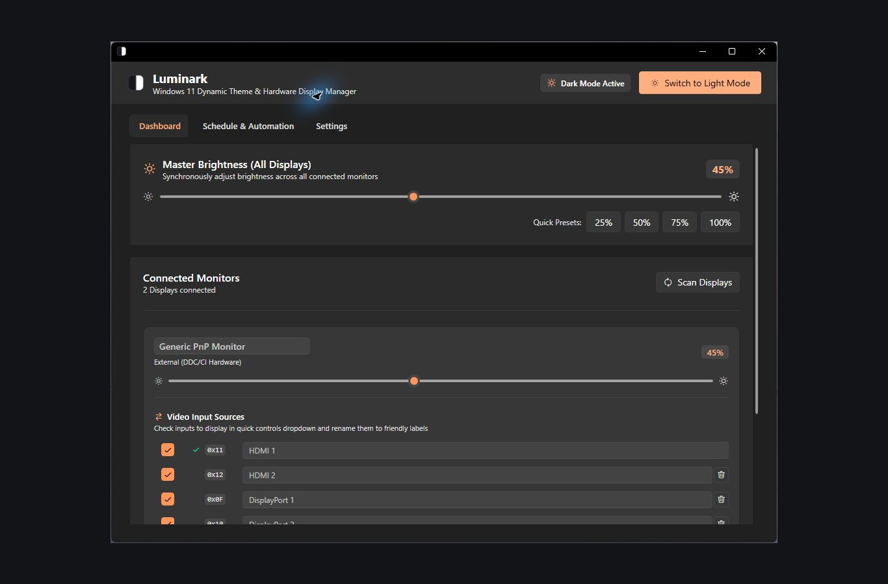
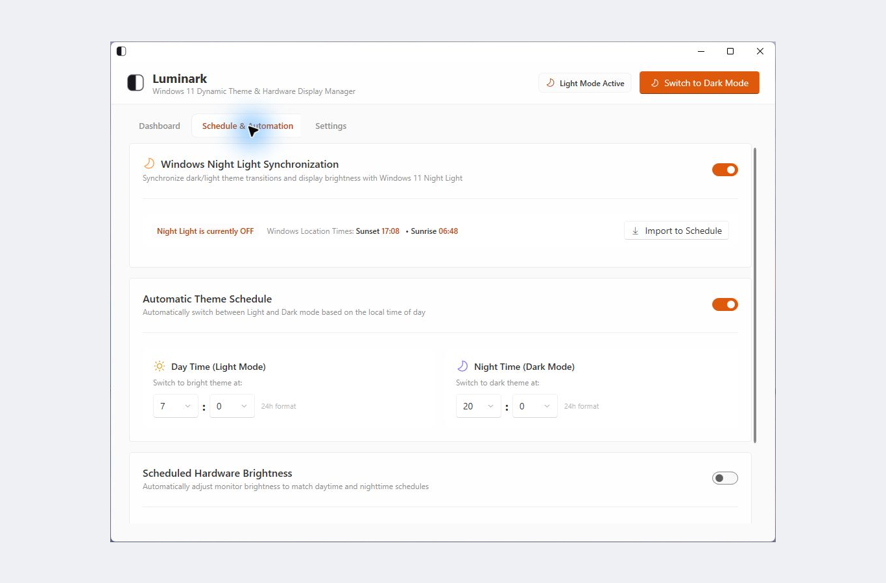

[**Website & downloads ↗**](https://silviuk.github.io/Luminark/) · [Latest release](https://github.com/silviuk/Luminark/releases/latest)

# Luminark

Adjust your monitor brightness and switch between light and dark mode from the Windows tray. You can set each screen separately, change them all together, or let a schedule take care of it.

**Windows 11 · Display & theme control**

## What you can do

- **Adjust one screen or all of them.** Use the master slider for all screens, or adjust each one separately. Preset buttons make it easy to return to a brightness you like.
- **Set a schedule.** Choose when to change themes and brightness, or have Luminark follow Windows Night Light.
- **Keep the controls close.** Scroll over the tray icon to change brightness. Open the tray window for monitor input and volume controls where supported, or to keep the computer awake or turn the screens off.

## Screenshots

*Brightness and monitor controls in the dark-mode dashboard.*

*Schedule theme changes or follow Windows Night Light.*

## Get started

1. Download the latest Windows installer from GitHub Releases and launch Luminark.
2. Click the tray icon and check that your screens appear. You may need to turn on DDC/CI in your monitor’s own menu.
3. Set your brightness levels and choose a schedule or Windows Night Light synchronization.

### Tray shortcuts

| Gesture | Action |
| --- | --- |
| Click | Open quick controls |
| Double-click | Toggle light / dark theme |
| Scroll over icon | Adjust master brightness by 5% |
| Right-click | Open the tray menu |

## Before you start

Windows 11. External monitor brightness, input, and speaker controls depend on the monitor’s DDC/CI capabilities; built-in laptop brightness depends on WMI support. Source builds use the .NET SDK pinned by global.json.

The controls you see depend on your monitor and how it’s connected. Some monitors, docks, and adapters don’t support every DDC/CI function.

## More information

See [development, validation, and release instructions](docs/DEVELOPMENT.md).

Something not working, or have a suggestion? [Open an issue](https://github.com/silviuk/Luminark/issues). If you’d like to support my work, [you can leave a tip on Ko-fi](https://ko-fi.com/silviuvlasceanu).

© 2026 Silviu Vlasceanu. [License](LICENSE).
